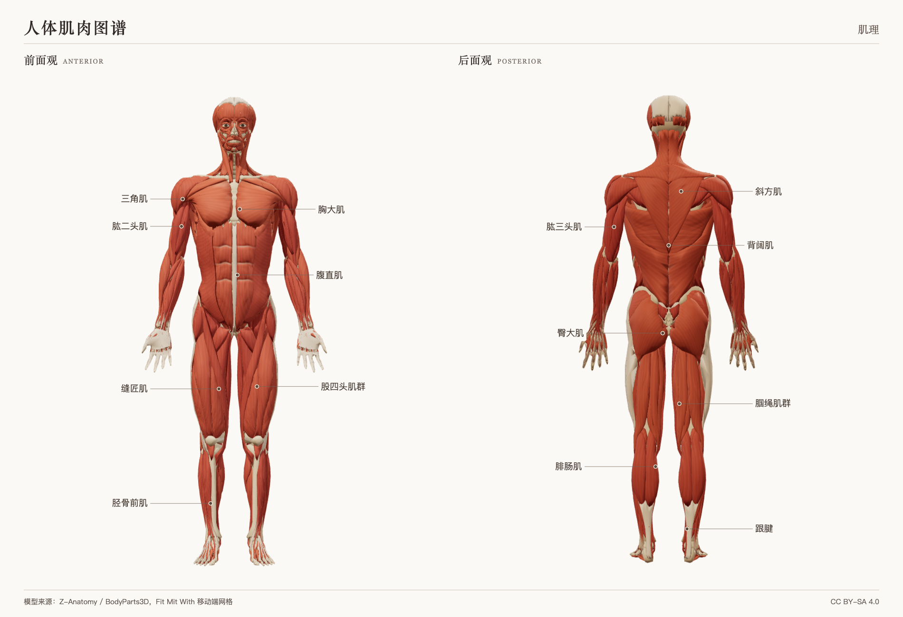

# 人体肌群解剖版

这个 Skill 的主要作用是帮你**认识身体的每一块肌肉**。打开三维人体，点一下想了解的部位，选中的肌肉就会高亮。你可以读到它的中文名称、左右侧、所属肌群、位置和主要动作，再从另一个角度看看它与周围结构的关系。

当前版本有 **51 个目录条目**。模型可点选 218 个左右侧肌肉或分束区域，另外可分别点选两侧跟腱。头、手、足的一部分小结构作为定位参照合并显示。



## 安装到你的 Agent

直接把这句话发给你的 Agent：

> 帮我安装这个 Skill：https://github.com/panggungunvibe/human-muscle-atlas

## 怎么用

> 打开「人体肌群解剖版」，帮我找到缝匠肌，看看它属于哪个肌群。

## 资料来源

| 内容 | 来源与处理 |
| --- | --- |
| 三维解剖结构 | 使用 [Fit Mit With anatomy atlas](https://github.com/slfresh/fitmitwith-anatomy-atlas/tree/4120ee68b6604b8f2f69105d6de6166fad4734c4) 整理的移动端网格，源自 [Z-Anatomy](https://github.com/Z-Anatomy/Models-of-human-anatomy) 和日本生命科学数据库中心的 [BodyParts3D](https://dbarchive.biosciencedbc.jp/en/bodyparts3d/download.html)。本版分离了左右跟腱，局部展示腹直肌和颈部结构，并添加了纤维示意材质、眼部细节和中文选区。 |
| 中文名称与肌群分区 | 参考维基百科[《人体肌肉列表》](https://zh.wikipedia.org/wiki/人體肌肉列表)，按头颈、躯干、上肢和下肢整理目录。 |
| 肌肉位置与主要动作 | 参考 OpenStax《Anatomy and Physiology 2e》第 11 章的[头颈与背部](https://openstax.org/books/anatomy-and-physiology-2e/pages/11-3-axial-muscles-of-the-head-neck-and-back)、[腹壁与胸廓](https://openstax.org/books/anatomy-and-physiology-2e/pages/11-4-axial-muscles-of-the-abdominal-wall-and-thorax)、[肩带与上肢](https://openstax.org/books/anatomy-and-physiology-2e/pages/11-5-muscles-of-the-pectoral-girdle-and-upper-limbs)及[骨盆带与下肢](https://openstax.org/books/anatomy-and-physiology-2e/pages/11-6-appendicular-muscles-of-the-pelvic-girdle-and-lower-limbs)，以中文概述。 |

## 源码与许可

- [SKILL.md](SKILL.md) 是技能入口，[启动脚本](scripts/launch.py) 提供本机预览，[viewer](viewer/) 包含可编辑的网页源码。
- Skill 指令、启动脚本和原创界面代码使用 [MIT License](LICENSE)。第三方库沿用各自许可。
- 三维模型、解剖模型改编及本页正背面渲染图适用 [CC BY-SA 4.0](https://creativecommons.org/licenses/by-sa/4.0/)。转载或改编时，请保留[模型署名与改动记录](assets/atlas/models/credits.txt)，并按相同许可分享模型改编。

如果要修改网页，在 `viewer/` 内编辑源码后，回到仓库根目录运行下面两条命令重建网页。重建产物会写入 Skill 自带的 `assets/atlas/`。

```sh
npm --prefix viewer ci
npm --prefix viewer run build
```
